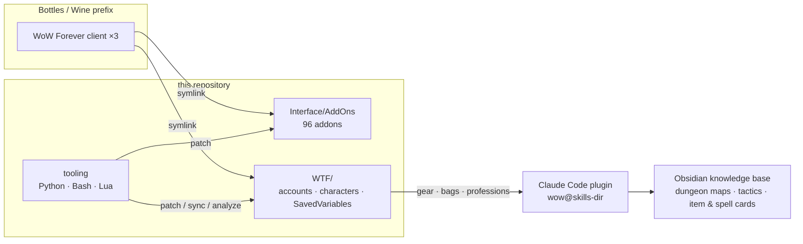

# WoW Forever — UI as Code

> A version-controlled, scriptable, AI-assisted game client configuration for a two-character
> multibox setup on **World of Warcraft: Forever** (Interface `16001`, Linux / Wine).

The game client doesn't keep a copy of its UI. Its `Interface/` and `WTF/` folders are **symlinked into
this repository**, so every addon, profile, keybind and SavedVariable is tracked in git. You can diff it,
roll it back and reproduce it on another machine.



## Highlights

| Area | What it does |
|---|---|
| **Live-linked client** | `Interface` and `WTF` are symlinks into the repo. Saving in game is a working-tree change, and every session is a commit away from being restored. |
| **Multibox duo** | Warrior tank/DPS plus Priest healer, played as one unit. Party frames ([Grid2](https://www.curseforge.com/wow/addons/grid2)), click-casting, and focus-based priest macros are tuned for a two-character party. |
| **Cross-account SavedVariables** | `link-ui-settings.sh` shares UI addon state from the main account to the others through relative symlinks. It is idempotent, refuses to run while the client is up, and backs up before every change. |
| **Nameplate engineering** | [Plater](https://www.curseforge.com/wow/addons/plater-nameplates) profiles with a custom `Execute Green` mod that hooks the health-cutoff API, because the Forever client takes Plater's "midnight" code path, where the built-in execute indicator does nothing. |
| **Economy tooling** | TradeSkillMaster scripts: a patch that makes Account Sync work between accounts on the same Battle.net, settings templating, guide-group import, and an inventory analyzer that cross-references prices, recipes and leveling guides into keep / sell / vendor decisions. |
| **AI-assisted planning** | A [Claude Code](https://claude.com/claude-code) plugin reads this repo (equipped gear, bags, professions) and writes an Obsidian knowledge base: interactive dungeon maps, Dungeon-Journal-style boss tactics split by role, and in-game-style item and spell tooltip cards. |

## Repository layout

```
Interface/AddOns/        addons as installed (CurseForge, "Forever" flavor), plus local patches
WTF/
  Config.wtf             client CVars
  Account/<acc>/         account-wide SavedVariables, macros, bindings
    93/<Character>/      per-character SavedVariables and layout
link-ui-settings.sh      share addon settings across accounts (symlinks)
tsm-*.py                 TradeSkillMaster patch / apply / import / analyze
tsm-export-inventory.lua inventory export used by tsm-analyze.py
CLAUDE.md                operational knowledge: quirks, profiles, safe-edit procedure
```

## The SavedVariables contract

The client owns its state. It writes SavedVariables on **logout and `/reload`**, so it overwrites any
edit made to a file while a character is logged in. Every tool here follows the same procedure:

1. **Quiesce:** the account's characters sit at character select, or the client is closed (`pgrep -fa Wow.exe`).
2. **Snapshot:** back up before writing.
3. **Transform:** load → modify → serialize. No blind text edits on structured data, and no `%q` number
   formatting on Lua 5.4+, because it emits hex floats.
4. **Validate:** `luac -p` and a `dofile()` round-trip.
5. **Verify after the next login/logout cycle.**

## Getting started

```bash
git clone git@github.com:bergandre/wow-forever-addon-settings.git ~/repositories/wow-forever-addon-settings
cd "<wine-prefix>/drive_c/Program Files (x86)/World of Warcraft/_forever_"
mv Interface Interface.orig && mv WTF WTF.orig          # keep the originals
ln -s ~/repositories/wow-forever-addon-settings/Interface Interface
ln -s ~/repositories/wow-forever-addon-settings/WTF WTF
```

Account folders are tied to the original Battle.net account. On another account, use the repo as a
reference and copy profiles over, not the whole `WTF/` tree.

## Engineering notes

Findings about the Forever client that cost time to work out are recorded in [`CLAUDE.md`](CLAUDE.md). For example:

- Plater on Forever runs its "midnight" code path. Aura tracking matches **by spell ID only**, and unit GUIDs are
  secret values that taint comparisons.
- Grid2's single icon indicator shows only its highest-priority aura status; lower ones mapped to it never render.
- Global `GetSpellInfo` doesn't exist. Use `C_Spell.GetSpellInfo`.

## Credits

All addons belong to their authors and are included here only to keep the setup reproducible. The
configuration, scripts and documentation are this repository's own work. World of Warcraft is a
trademark of Blizzard Entertainment; this project is not affiliated with Blizzard.
